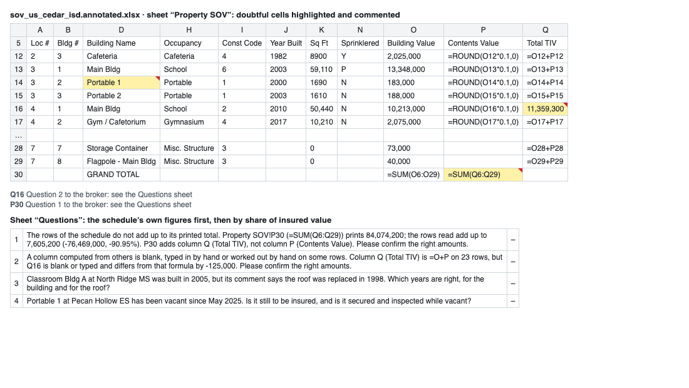
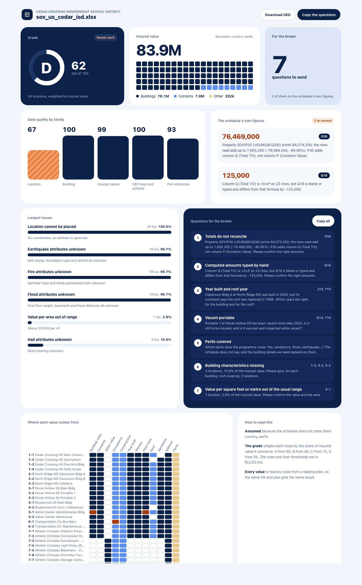
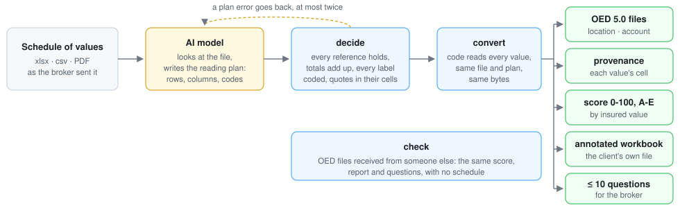

# sov2oed

**Turn a statement of values into OED exposure files, grade them, and ask the broker only what is missing.**

Give it the schedule of locations a broker sent, an Excel workbook, a CSV file or a PDF in any layout. You get:

- the exposure in [OED 5.0](https://github.com/OasisLMF/ODS_OpenExposureData), the Open Exposure Data standard,
  ready for a catastrophe model or a reinsurance submission;
- a quality grade from A to E, weighted by insured value, with the issues that matter most;
- the client's own workbook, with every doubtful cell highlighted and commented;
- at most ten questions for the broker, in the broker's language.

Every value comes from a cell of the schedule, and the files say which one. Nothing is invented; what is assumed
is marked.

## What you get

| Output | What it is |
|---|---|
| `location.csv`, `account.csv` | OED 5.0 files |
| `provenance.csv` | for each location and field: declared, derived, assumed or unknown, and the cell it comes from |
| `report.html`, `report.json` | a score from 0 to 100 and a grade from A to E, weighted by insured value: the largest issues, the schedule's own figures to correct, the questions for the broker, and where each value comes from |
| `<file>.annotated.xlsx` | the client's workbook: doubtful cells highlighted and commented, a "Questions" sheet, and a "Location no." column when the schedule has none |
| `questions.txt` | the questions for the broker: the schedule's own figures first, then the points the model found in the file (each citing its cells), the perils if the schedule does not name them, then the missing building characteristics |
| `conversion.json`, `plan.yaml` | how the file was read: rows read and skipped, values, what was assumed, the checks on the schedule |

**The annotated workbook**, sent back to the broker with the questions:



**The quality report:**



Both come from [`fixtures/sov_us_cedar_isd.xlsx`](fixtures/sov_us_cedar_isd.xlsx), a fictional school district.

## Architecture



An AI model looks at the schedule and writes a reading plan: which rows, which columns, what each label means in
OED codes. Published code checks the plan against the whole file (totals, formulas, rows and sheets left out,
labels with no code) and sends errors back to the model. Then the code reads every value and writes the outputs:
the same file and the same plan give the same bytes. OED files received from someone else can be graded alone,
with no schedule.

The model is the one already in your assistant: Claude, or any assistant that can run Python or call an MCP
server. sov2oed itself calls no model and no network, except in `sov2oed auto`, which calls a model you choose.

[How it works, in detail](docs/how-it-works.md): the reading plan, PDF schedules, the checks, the score, the
questions, the modules.

## How to use it

**In the Claude app (claude.ai or desktop), with no code.**

1. In Settings, turn on code execution.
2. Upload [`sov2oed-skill.zip`](https://github.com/Duflosth/sov2oed/releases/latest) under Skills.
3. Drop a schedule into a conversation and ask "convert this SOV to OED".

The skill carries its own code and needs no network access. On a Team or Enterprise plan, an owner can add it for
the whole organisation.

**In Claude Code**, as a plugin that carries the same skill:

```bash
/plugin marketplace add Duflosth/sov2oed
/plugin install sov2oed@sov2oed
```

**As an MCP server**, for any MCP client: five tools, `inspect`, `rows`, `decide`, `convert` and `check`, that read
and write only under the folder they are started in.

```bash
pip install -e ".[mcp]"
claude mcp add sov2oed -- python -P -m sov2oed.mcp_server   # Claude Code; other clients: the same command
```

**With another coding assistant** (GitHub Copilot, Codex, Cursor): open this repository; [AGENTS.md](AGENTS.md)
tells the assistant how to run a conversion with the command line.

**From the command line:**

```bash
pip install -e .
sov2oed inspect schedule.xlsx                          # sheets, tables, formulas; --sheet, --page, --codes
sov2oed rows schedule.pdf schedule.rows.py --out schedule.rows.csv   # a PDF: the model's script groups its lines
sov2oed decide schedule.xlsx schedule.plan.yaml        # does the plan hold for this file?
sov2oed convert schedule.xlsx schedule.plan.yaml --out out/
sov2oed check location.csv --account account.csv --out report/   # OED files received from someone else
```

**On its own, with an API key** (`sov2oed auto`): a model does the same steps with no assistant, then writes the
broker message in the schedule's language. The schedule's content is sent to the model's provider.

```bash
pip install -e ".[anthropic]"                          # or ".[openai]" for an OpenAI-compatible endpoint
sov2oed auto schedule.xlsx --out out/                  # --llm anthropic:claude-opus-5-5 by default
sov2oed auto schedule.pdf --out out/ --llm openai:<model> --base-url https://<endpoint>/v1
```

With Claude, a request the model declines is retried on another Claude model on Anthropic's side; `agent.json`
says which model answered.

## Scope and limits

- **Inputs:** property schedules in Excel (`.xlsx`, `.xlsm`), CSV, and PDF with a text layer. Save `.xls` and
  `.ods` files as `.xlsx` first.
- **Not covered:** scanned PDFs (no OCR), e-mails, marine, cyber and liability exposures, reinsurance files.
- **No geocoding and no external data.** Coordinates are checked, not created.
- **The account file** holds what the schedule states: keys, currency, perils, and any limit or deductible it
  quotes. Policy terms from the slip must be added.
- **Outputs are in English.** The model words the broker message in the broker's language.
- **Tested with Claude.** The plan format is strict and has a JSON schema, so other models should follow it; how
  well they do is not measured yet.

## Development

```bash
python -m venv .venv && .venv/bin/pip install -e ".[dev,mcp]"
.venv/bin/pytest
.venv/bin/ruff check . && .venv/bin/ruff format --check . && .venv/bin/mypy
python tools/build_skill.py                                     # dist/sov2oed-skill.zip and plugin/skills/
python tools/readme_images.py --browser /path/to/chromium       # docs/img/report.png, workbook.png
```

The tests run on fictional schedules only. A test refuses any file whose digest is in a list of real schedules
kept outside the repository.

## Licence

Apache-2.0, see [LICENSE](LICENSE) and [NOTICE](NOTICE); privacy: [PRIVACY.md](PRIVACY.md). The OED specification bundled in `sov2oed/data` is CC0, by
Oasis LMF. sov2oed is an independent project, not endorsed by Oasis LMF or any other organisation.
