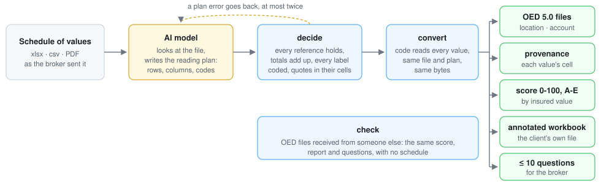

# How sov2oed works

An AI model looks at the schedule and writes a reading plan; published code checks the plan against the file and
reads every value. The model does what it does well, recognising a layout and what its labels mean; the code does
what must be exact and repeatable. The same file and the same plan give the same bytes.

## The reading plan

The plan holds structure and classification only:

- the sheet or the PDF pages of each table, its header rows, its data rows and its total rows;
- the OED field of each column, and the code of each label of a coded column (occupancy, construction, roof);
- the basis of each money column: replacement cost, market value, actual cash value, agreed value, a policy
  limit, or unknown;
- the rows that are not buildings (playground equipment, signs, generators), the unit of areas and amounts;
- the points of this file to ask the broker that only a reading finds, each with the cells it is about.

Any value that is not a code, such as the insured's name, the currency or a fact taken from a note, comes with the
cell it is in and an exact quote of it. What has neither is marked assumed, and the report lists it. The format
is described in [`sov2oed/data/plan_guide.md`](../sov2oed/data/plan_guide.md) (`sov2oed inspect --guide`), with
a JSON schema (`sov2oed inspect --plan-schema`) and a complete example (`sov2oed inspect --example plan`).

## PDF schedules

A PDF has no cells, and its rows are rarely one line each: a location printed over several lines, amounts on the
line above the name, an address under it. The model writes a short script, `rows(lines)`, that gets the PDF's
lines with the position of each word and groups them into rows, one per location. The script runs in a separate
interpreter with no file access, a short list of pure modules and a time limit.

Its output, the rows file, names in its first column the PDF lines each row was read from (`p3:l12-l13`); the
plan then reads it like a sheet. The code checks every value against the lines its row names, and that no line
printing an amount is left out of every row. The script and the rows file are kept with the outputs.

## The checks on the plan

`decide` reads the plan against the file. A plan error goes back to the model, which fixes the plan, at most
twice:

| Check | What it finds |
|---|---|
| totals | rows that do not add up to a printed total, each section to its subtotal; a SUM that leaves rows out or adds another column |
| row totals | a row whose printed total its amounts do not reach |
| formulas | a computed column typed over by hand on some rows, or worked out by hand (`=350000+50000`) |
| rows | a row of the table neither read nor skipped with a reason |
| sheets | a sheet with numbers, hidden or not, neither read nor listed as not needed |
| codes | a label of a coded column with no OED code |
| quotes | a quote that is not in its cell, or a number of the value that is not in the quote |
| overlap | the same rows read in two tables |
| unreadable | text where an amount is expected (`n/k`, `as last year + inflation`) |
| PDF rows | a value not printed on the lines its row names; a line printing an amount left out of every row |

A finding about the schedule itself, such as a printed total that its rows do not reach, is not an error of the
plan: it becomes the first question to the broker.

## The quality score

Sixteen rules grade the OED files, in four families:

- **where:** an address that can be placed, valid coordinates;
- **what:** construction, occupancy, storeys, year, floor area, impossible or default values, wind and flood
  attributes for the perils covered;
- **value:** missing values, value per area, values 100 times off, a basis that is not replacement cost;
- **link:** duplicates, the OED schema.

Each finding is weighted by the share of insured value it concerns, and the score runs from 0 to 100, with a
grade from A to E. The rules and their thresholds are in [RULES.md](../RULES.md), the score in
[scoring.md](scoring.md).

## The questions to the broker

The questions ask only what the broker alone can give, in the words of a property schedule, at most ten in all:

1. the schedule's own figures: a total that does not add up, a value typed over a formula;
2. the points of this file that only a reading finds, which the model writes in the plan (at most five): two
   insureds in one schedule, a row whose total is not its building plus contents, flood amounts that are capped
   limits. Each cites its cells with exact quotes; code checks them, as it checks a fact, and drops a question
   whose quote is not in its cell;
3. which perils the programme covers, when the schedule does not say;
4. the missing building characteristics, in one question: construction, use, year built, storeys, floor area and
   roof while the perils are not known; the details of the covered perils (flood defences, seismic retrofit,
   window protection) once they are;
5. the rest, largest share of the insured value first: values off their range, duplicates, a value basis that is
   not replacement cost or is not given.

Nothing that sov2oed or a cat team does itself, such as placing an address on the map or the form of the OED
files, is asked. The model writes the message in the broker's language.

## Modules

| Module | Role |
|---|---|
| `read/grid.py`, `read/inspect.py` | load xlsx, csv and PDF into one grid; the views the model looks at |
| `plan.py` | the plan's schema and its references (sheets, rows, columns, OED fields, codes) |
| `sandbox.py` | runs a PDF rows script without file or network access |
| `extract.py`, `parse.py` | plan + file → locations, each value with its status and source cell |
| `guards.py` | the checks on the plan above |
| `oed/` | the OED 5.0 specification and the writer of location, account and provenance files |
| `check/` | load any OED file, schema checks, the sixteen rules, the score |
| `report/`, `questions.py`, `annotate.py` | the quality report, the broker questions, the annotated workbook |
| `pipeline.py` | the steps shared by the command line, the MCP server and the skill |
